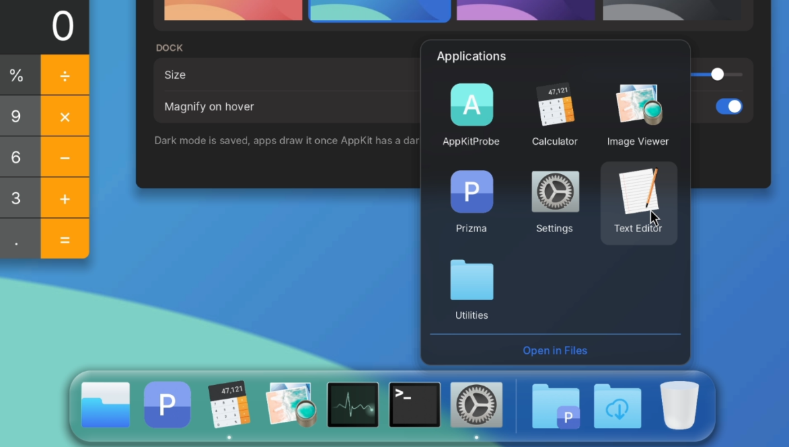
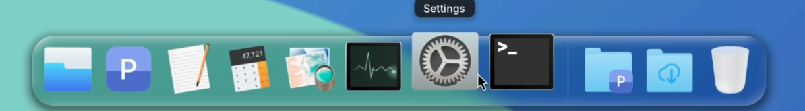

# pd-instadock

A Dock for PureDarwin's Argon desktop, built as a drop-in replacement for `/System/Library/CoreServices/Dock.app`.
Like the stock Dock it also draws the desktop picture, and it reads the same preferences (`org.puredarwin.Dock`).

[](https://www.youtube.com/watch?v=b2qlmIyp3NA)

▶ [Watch the demo on YouTube](https://www.youtube.com/watch?v=b2qlmIyp3NA)





## Features

- liquid glass bar: the desktop picture behind the bar is blurred, refracted through a convex rim
  (Snell's law, after kube.io's "Liquid Glass in the Browser") and lit along its edge, all on the CPU
- macOS-style magnification that follows the pointer, launch bounce, running app dots
- pin and unpin apps (context menu, drag off the dock, drag onto the Trash, or the settings window)
- drag to reorder apps and stacks
- Stacks: folders open as a grid popup above the dock
- Trash with item count, its contents as a stack, emptying with confirmation
- context menus: open, keep in dock, quit, force quit, remove, dock options
- auto-hide (then the dock reserves no screen space)
- settings window: size, magnification, glass strength, auto-hide, indicators, apps and stacks

## Preferences (`org.puredarwin.Dock`)

| Key | Meaning |
|---|---|
| `TileSize` | tile size, 32–72 (shared with PD Settings) |
| `Magnify` | magnification on or off (shared with PD Settings) |
| `DesktopPicture` | name in `/System/Library/Desktop Pictures` or a path (shared with PD Settings) |
| `MagnifiedSize` | magnified tile size, up to 128 |
| `AutoHide`, `ShowIndicators` | booleans |
| `Glass` | 0–1, refraction and rim light |
| `PersistentApps`, `PersistentStacks` | arrays of paths |

## Building

Uses the toolchain of the puredarwin-vm repository (Zig, ld64, the PD SDK taken from the VM image), `PDVM`
defaults to `~/vm`. The icons are rendered from PureDarwin's own SVGs at commit `b2c1916` (Trenta, CC BY-SA 4.0).

```
./build.sh            # build/Dock.app
./build.sh --install  # install into the VM, keeping the stock Dock as .Dock.app.original, and restart the Dock
./build.sh --restore  # put the stock Dock back
```

## Debugging

Environment switches, given to the Dock that `--install` starts with `ID_ENV`, for example
`ID_ENV="ID_DEMO=1 ID_PROFILE=1" ./build.sh --install`; the Dock logs to `/var/log/dock.log` in the VM.

| Switch | What it does |
|---|---|
| `ID_DEMO=1` | three seconds after start a virtual pointer sweeps the bar for six seconds |
| `ID_PROFILE=1` | logs the time of the parts of a frame and of the whole frame every 10 frames |
| `ID_PREFS=1` | opens the settings window three seconds after start and logs its drawing |
| `ID_TRACE=1` | logs the screen and the two dock windows' frames every five seconds |

## Known limits

- PureDarwin cannot bring another app's windows forward yet, so clicking a running app only hops its tile.
- Finder cannot be opened at a folder yet, so "Open in Files" opens Finder at home.
- The glass refracts the desktop picture; with auto-hide a window under the dock is not seen through it.

Licensed MPL-2.0 OR BSD-2-Clause, see `LICENSE`.
